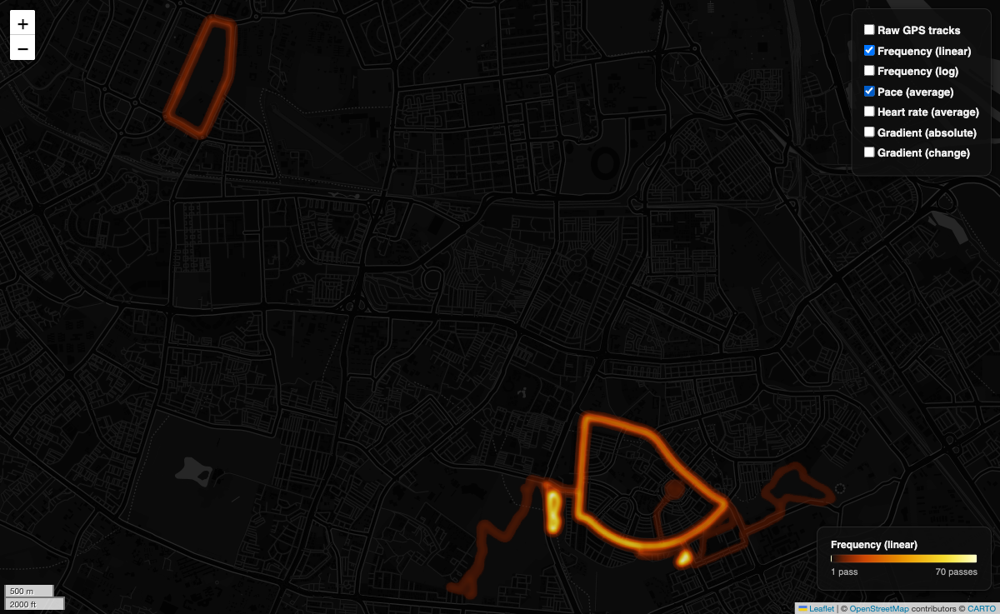

# Running Heatmap

Turns a Strava data export into an interactive heatmap of your runs - no Strava API needed, just the zip file Strava lets you download. The output is a single self-contained HTML file.


## Fork notice

This repository is a fork/copy of [moresamwilson/running-heatmap](https://github.com/moresamwilson/running-heatmap) by **Sam Wilson** (MIT licensed). The original was shared alongside the YouTube video:

- **Video:** [I Built Strava's Best Feature for Free](https://youtu.be/PA8d4u5T4BM)
- **Original repository:** https://github.com/moresamwilson/running-heatmap
- **License:** MIT, see [LICENSE](LICENSE)

Full credit for the project itself goes to Sam Wilson. This fork only adjusts the config cell for personal use and documents how it works.

## The map

A single HTML file with six layers you can switch between, plus the raw GPS tracks:

| Layer | Colour | Shows |
|---|---|---|
| Frequency (linear) | Orange | How often you've run each path |
| Frequency (log) | Orange | Same, log scale - better when a few paths dominate |
| Pace (average) | Blue | Average pace - brighter = faster |
| Heart rate (average) | Red | Average HR - brighter = higher |
| Gradient (absolute) | White | Steepness - brighter = steeper |
| Gradient (change) | Green / purple | Direction - green = descending, purple = ascending |




## Setup

```
pip install -r requirements.txt
```

## Usage

1. Request your data from Strava: **Settings → My Account → Download or Delete Your Account → Download Request**
2. Unzip the export and place the folder next to `heatmap.ipynb`
3. Update the config cell:

```python
ACTIVITIES_DIR = "strava_export"   # name of the unzipped folder
ACTIVITY_TYPES = ["Run"]           # Run, Ride, Hike, Walk, ...
DATE_FROM      = "2024-01-01"      # or None for no lower limit
DATE_TO        = "2024-12-31"      # or None for today
```

4. Run all cells. The map is saved to `outputs/heatmap.html`.

### Home detection

Home is auto-detected from the most common activity start point in the date range, then only activities within `RADIUS_KM` of that point are included. It's a heuristic - if you started more runs from somewhere else (work, a club) than home in that period, that location wins. Override it with `HOME_LAT` / `HOME_LON` if needed.

### Caching

Parsing `.fit.gz` files is slow, so GPS data is cached after the first run. Changing the date range or config won't re-parse files you've already loaded.

## How it works

- **Home detection** bins activity start points onto a ~1 km grid and picks the densest cell (haversine distance on a 6371 km sphere)
- **Raster grid** is built in Web Mercator (EPSG:3857) so pixels align directly to the map tile basemap, then painted with a Bresenham-style segment rasteriser with per-pixel running averages for speed, HR and gradient
- **Real-world measurements** (the clip radius around home, and rise/run gradient) use a local UTM projection instead, because Web Mercator distorts distances at higher latitudes
- **Glow** comes from a Gaussian blur over the painted grids, composited with configurable opacity

## Notes

### The frequency map measures time on path, not number of passes

GPS records at ~1 Hz, so the frequency layers count GPS samples per pixel rather than distinct activities. A slower run deposits more points on the same path than a faster one. In practice this means the map shows something closer to time spent on each road than how many times you've run it - which is arguably more useful, but worth knowing.

The log scale version exists because a few favourite routes tend to dominate completely on a linear scale, washing out everything else.

### Pace and HR are all-time averages

Each pixel is the mean across every activity that ever crossed it. A route you used to run slowly but now run fast will show somewhere in the middle. Narrow the date range if you want a specific period.

### The gradient layers are only as good as GPS altitude

GPS altitude is much noisier than horizontal position - typically ±10-20 m vertically versus ±3-5 m horizontally. The gradient layers are reliable on hilly terrain but can look noisy on flat routes where the signal-to-noise is poor.

## License

MIT - see [LICENSE](LICENSE). Copyright (c) 2026 Sam Wilson.
